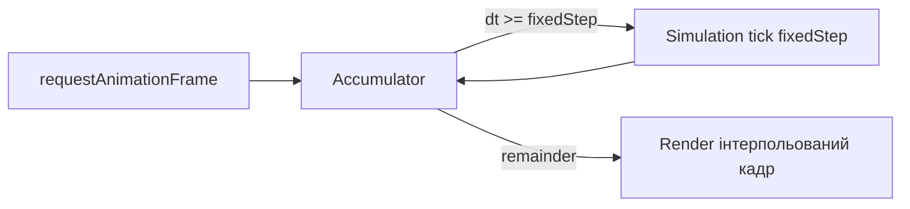
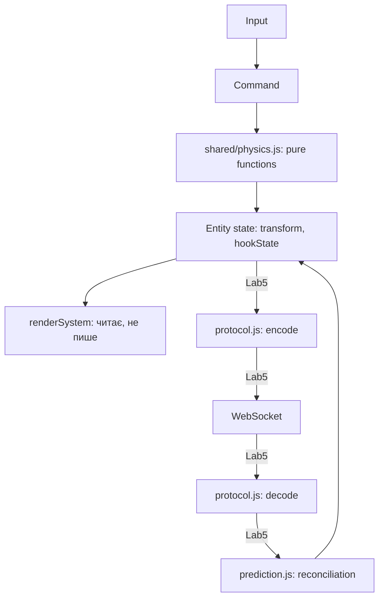
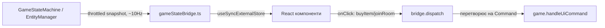

# Hookline — архітектура проєкту

Технічна структура, яка росте разом з лабами, але закладається одразу так, щоб Lab 5 (мережа) і Lab 6 (типи) не вимагали переписування Lab 1–2. Головний принцип: **симуляція — це чисті дані й чисті функції над ними**, рендер і мережа лише читають/серіалізують цей стан, ніколи не є джерелом істини.

---

## 1. Структура монорепо (кінцевий стан, після Lab 5)

```
hookline/
├── package.json              # root, npm workspaces
├── .nvmrc
├── PLAN.md
├── ARCHITECTURE.md
├── client/                   # з'являється в Lab 1
│   ├── index.html
│   ├── vite.config.js
│   └── src/
│       ├── main.js           # bootstrap: loading → gameloop
│       ├── core/
│       │   ├── loop.js       # fixed-timestep accumulator (Lab 1)
│       │   └── time.js
│       ├── input/
│       │   └── inputToCommand.js   # клавіші → Command (Lab 1, переговорюється в Lab 5)
│       ├── entities/
│       │   ├── Entity.js
│       │   ├── Player.js
│       │   ├── Hook.js
│       │   ├── Tree.js
│       │   ├── GoldPickup.js
│       │   └── EntityManager.js    # Map<id, Entity> (Lab 2)
│       ├── systems/
│       │   ├── movementSystem.js
│       │   ├── hookSystem.js
│       │   ├── collisionSystem.js
│       │   ├── renderSystem.js
│       │   └── audioSystem.js      # Lab 3
│       ├── state/
│       │   └── GameStateMachine.js # Loading/Lobby/Playing/RoundEnd
│       ├── net/                    # Lab 4–5
│       │   ├── connection.js
│       │   ├── prediction.js
│       │   └── interpolation.js
│       ├── ui/                     # Lab 6+, React — тільки HUD/лобі/крамниця
│       │   ├── main.tsx            # окремий React root, монтується поверх canvas
│       │   ├── App.tsx
│       │   ├── gameStateBridge.ts  # міст vanilla-гра ↔ React (без React-стану симуляції)
│       │   └── components/
│       │       ├── Hud.tsx
│       │       ├── ShopModal.tsx
│       │       ├── KillFeed.tsx
│       │       └── LobbyScreen.tsx
│       └── assets/
├── server/                   # з'являється в Lab 4, Lab 4–5 — сирий Node (навчальна вимога)
│   └── src/
│       ├── index.js          # http + ws bootstrap
│       ├── Room.js
│       ├── RoomManager.js    # extends EventEmitter
│       ├── simulation/
│       │   └── authoritativeLoop.js  # той самий код, що й client/core/loop.js, але з shared/
│       ├── net/
│       │   └── messageHandlers.js
│       └── logging/
│           └── matchLog.js   # append-only стрім, Lab 4
│                              # ↓ Lab 6+: обгортається в NestJS, див. розділ 8 — Room/RoomManager/matchLog не переписуються, а переносяться в сервіси
└── shared/                   # з'являється в Lab 5
    └── src/
        ├── constants.js      # розміри арени, швидкості, дальність гачка
        ├── physics.js        # інтеграція руху, гачка, колізій — ОДИН раз, юзається і клієнтом (prediction), і сервером (authority)
        └── protocol.js       # форми повідомлень; стає discriminated union у Lab 6 (TS)
```

До Lab 4 існує лише `client/` — і це нормально, `server/` та `shared/` не мокаються заздалегідь, вони буквально з'являються, коли лаба цього вимагає.

---

## 2. Ігровий цикл і пайплайн систем

Fixed-timestep симуляція (Lab 1), рендер — окремо на `requestAnimationFrame`:



Кожен `SIM` тік виконує системи в фіксованому порядку над `EntityManager`:

```
input → movementSystem → hookSystem → collisionSystem → (net: apply server state, Lab5+)
```

`renderSystem` і `audioSystem` виконуються поза fixed-тіком, на кожному кадрі рендеру, і **тільки читають** стан сутностей.

---

## 3. Модель сутностей: композиція, не глибока ієрархія

`Entity` — не Bag of Behavior через `extends`, а контейнер компонентів-даних:

```
Entity
├── id
├── transform   { x, y, angle }
├── velocity    { vx, vy }
├── collider    { radius }
├── sprite      { key }        // опційно — Tree/GoldPickup не рухаються
└── hookState   { phase: 'idle'|'flying'|'attached'|'retracting', targetId, ... }  // лише у Hook
```

`Player`, `Hook`, `Tree`, `GoldPickup` — це фабричні функції (`createPlayer()`, `createHook()`), що збирають потрібний набір компонентів, а не класи з `extends`. Один рівень `extends` (вимога Lab 2) лишається для `Entity → Player`, де в `Player` є не-компонентна поведінка (input-власник, здоров'я, золото) — решта через композицію.

`EntityManager` — `Map<id, Entity>`, системи фільтрують потрібні сутності через `has(component)` перед обробкою.

---

## 4. Машина станів гри

```
Loading → Lobby → Playing → RoundEnd → Lobby (rematch) | Loading (new assets)
```

Кожен стан — об'єкт `{ enter(), update(dt), draw(ctx), exit() }`; `GameStateMachine` тримає поточний і викликає лише його. Це ізолює екран завантаження (Lab 3) і лобі від ігрового циклу — `Playing` це єдиний стан, що ганяє `SIM`-тік.

---

## 5. Input → Command: проєктування наперед під мережу

Уже в Lab 1 input не читається системами напряму — він перетворюється щотік у **Command**:

```js
{ tick, moveX, moveY, fireHook: boolean, aimAngle }
```

`movementSystem`/`hookSystem` беруть `Command` як вхід, не `KeyboardEvent`. Це навмисно: у Lab 5 той самий об'єкт `Command` — це те, що серіалізується в бінарний пакет і йде на сервер, і те, що клієнт зберігає в буфері для reconciliation. Якщо зробити це з Lab 1, у Lab 5 не доведеться переписувати системи — лише додати серіалізацію.

---

## 6. Симуляція vs рендер vs мережа (дані одного напрямку)



`shared/physics.js` — чисті функції `(state, command, dt) → newState`, без звернень до `window`, `document` чи `WebSocket`. Це те, що дозволяє в Lab 5 запустити **той самий код** на сервері (authority) і на клієнті (prediction) без дублювання логіки гачка.

---

## 7. React UI-шар (Lab 6+)

Фреймворк дозволений курсом лише "де він заробляє своє місце" — тут це HUD/лобі/крамниця, які й так з'являються разом з TypeScript у Lab 6 (React-компоненти одразу пишуться як `.tsx` проти типів з `shared/protocol.ts`). **Canvas і game loop лишаються vanilla назавжди** — React ніколи не рендерить арену чи сутності, лише DOM-оверлей поверх `<canvas>`.

Ключове правило: **React не володіє станом симуляції**. `EntityManager`/`GameStateMachine` лишаються єдиним джерелом істини; React лише підписується на вузький, throttled зріз цього стану.

```
client/src/ui/
├── main.tsx            # createRoot(overlayDiv).render(<App/>)
├── App.tsx             # switch за GameStateMachine.current: Lobby | Hud+ShopModal | RoundEnd
├── gameStateBridge.ts  # pub/sub, читає snapshot з vanilla-гри
└── components/
    ├── Hud.tsx          # hp, gold, кулдаун гачка, рахунок
    ├── ShopModal.tsx    # клік "купити" → dispatch(Command) назад у гру
    ├── KillFeed.tsx
    └── LobbyScreen.tsx  # join/create room (Lab 4 net)
```

Потік даних односторонній в обидва боки окремо, без React, що тримає гру, чи гри, що тримає React:



- `gameStateBridge.ts` — маленький pub/sub (без Redux/Zustand: масштаб не виправдовує ще одну залежність), React підписується через `useSyncExternalStore`, щоб не тягнути весь snapshot у кожен рендер-цикл 60fps — оновлення UI навмисно рідші (HP/золото не змінюються щокадру).
- Дії з UI (купити предмет, приєднатись до кімнати) не мутують гру напряму — вони йдуть через той самий `Command`-конвеєр з розділу 5, тож `BuyItem` природно лягає в discriminated union протоколу Lab 6 поруч з мережевими повідомленнями.
- Vite-конфіг client/ отримує `@vitejs/plugin-react` тільки в Lab 6 — до того його немає, бо немає JSX.

---

## 8. NestJS на сервері (Lab 6+)

Курс явно дозволяє Fastify/NestJS "де він заробляє своє місце" — але **Lab 4–5 мають пройти на сирому Node**: `http`, `EventEmitter`, streams/backpressure і `ws` — це прямий предмет цих лаб, і ховати їх за фреймворком з першого дня означає не вивчити те, заради чого лаба існує. Тому послідовність така сама, як з React: Nest заходить рівно в Lab 6, одночасно з TypeScript (Nest — TS-first), і **переносить**, а не переписує з нуля логіку з Lab 4–5.

Обов'язкова умова: WebSocket-шлюз лишається на `ws`, не на Socket.IO (пряма вимога курсу — "ти вивчаєш протокол, а не обгортку"). Nest підтримує це нативно через `@nestjs/platform-ws` замість дефолтного Socket.IO-адаптера.

```
server/src/                        # Lab 6+, структура після міграції на Nest
├── main.ts                        # NestFactory + WsAdapter (не Socket.IO)
├── app.module.ts
├── rooms/
│   ├── rooms.module.ts
│   ├── rooms.gateway.ts           # @WebSocketGateway на 'ws' — те, що було messageHandlers.js
│   ├── room-manager.service.ts    # той самий RoomManager, тепер @Injectable(), extends EventEmitter лишається
│   └── room.entity.ts             # був Room.js
├── simulation/
│   └── authoritative-loop.service.ts  # викликає shared/physics.js, як і раніше — Nest тут лише DI-обгортка
├── match-log/
│   └── match-log.service.ts       # був matchLog.js, стрім у файл без змін
└── common/
    └── protocol.validation.ts     # zod-валідація вхідних повідомлень (Lab 6, розділ протоколу)
```

Що змінюється при переході на Nest: організація (модулі, DI, декоратори), тестованість (сервіси легко мокаються в Vitest, Lab 7), і місце для майбутнього REST-контролера (напр. `/leaderboard`), якщо знадобиться поза WebSocket-каналом.

Що **не** змінюється: `shared/physics.js` і бінарний протокол з Lab 5 не мають знати про існування Nest — вони лишаються plain-функціями/даними, які викликає сервіс, так само як їх викликав "голий" `authoritativeLoop.js` до міграції.

---

## Що НЕ проєктується наперед

- Немає заглушок `net/`, `shared/` чи TS-типів у Lab 1–3 — вони з'являються рівно тоді, коли лаба їх вимагає.
- React і NestJS з'являються рівно в Lab 6, не раніше — до того і клієнтський HUD, і сервер лишаються найпростішим vanilla варіантом, саме тому, що це прямий предмет Lab 1–5.
- Немає системи компонентів (ECS-фреймворку) для сутностей гри — композиція вручну на звичайних об'єктах, цього достатньо для масштабу проєкту.
