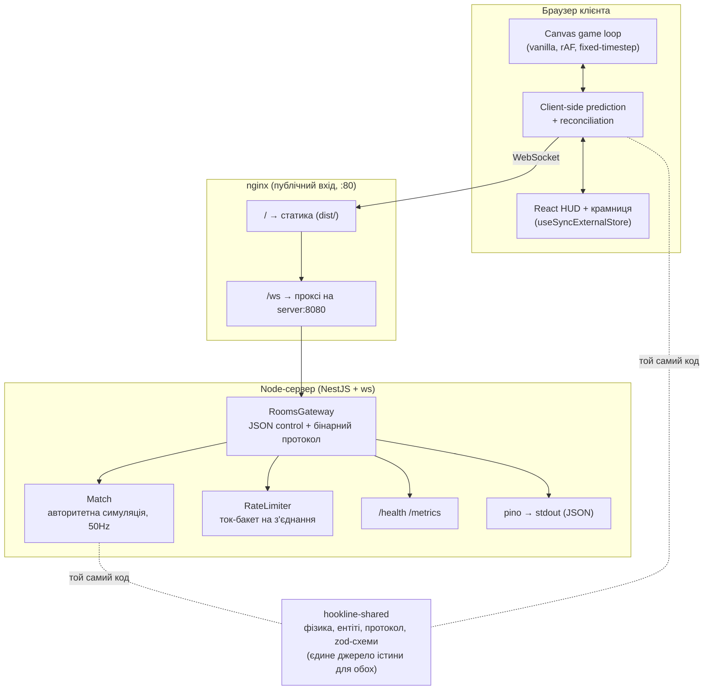

# Hookline

Мультиплеєрна браузерна арена в реальному часі — клон **Pudge Wars**. Двоє гравців, м'ясний гачок, річка з деревами посередині, авторитетний Node-сервер, client-side prediction, бінарний протокол, TypeScript, Docker.

Проєкт курсу [JavaScript — мультиплеєрна браузерна гра в реальному часі](https://github.com/rmalkevy/Programming-Practice-Projects/blob/main/courses/javascript/README.md), 8 лаб, кожна протегована в git (`lab-01` … `lab-08`).

## Демо

Два незалежні браузерні контексти (Playwright), кожен зі своїм WebSocket-з'єднанням, справжній рух і постріл гачком через реверс-проксі докер-стеку:

- [`demo/alice.webm`](demo/alice.webm) — перспектива гравця A
- [`demo/bob.webm`](demo/bob.webm) — перспектива гравця B

Записано командою `npm run demo:record` (потребує піднятого `docker compose up`).

## Керування

WASD — рух, миша — приціл, ЛКМ — вистрілити гачком. Влучив у ворога — тягнеш його до себе; протягнеш крізь дерево — бонусний урон. Золото за влучання, крамниця в HUD (бутси швидкості, подовжений гачок, реген).

## Архітектура



`shared/` — це не бібліотека утиліт, а буквальна гарантія: сервер (авторитетна симуляція) і клієнт (прогноз власного руху) викликають **одні й ті самі** функції фізики гачка/руху. Розбіжність між "що бачить клієнт" і "що вирішив сервер" структурно неможлива для тієї логіки, що там живе.

## Стек

| Шар | Технології |
|---|---|
| `client/` | Vite, TypeScript (strict), React (лише HUD/крамниця), Canvas 2D, Web Audio |
| `server/` | Node 22, NestJS, `ws` (не Socket.IO), pino, zod |
| `shared/` | TypeScript, zod — фізика, ентіті, бінарний протокол, JSON-схеми повідомлень |
| Тести | Vitest, fast-check (property-based), Playwright (e2e + запис демо) |
| Деплой | Docker (multi-stage), docker-compose, nginx (статика + WS-проксі), GitHub Actions CI |

## Протокол

Бінарний (не JSON) для геймплею — `DataView` над `ArrayBuffer`, фіксовані офсети (матч завжди 1v1, тож масиви без count-prefix):

| Пакет | Розмір | Еквівалент у JSON |
|---|---|---|
| Input (клієнт→сервер, 50/с) | **11 байт** | ~85-95 байт (~8× різниця) |
| Snapshot (сервер→клієнт, 50/с) | **60 байт** (2 слоти × 28 + 4) | ~300-400 байт (~5-6× різниця) |

JSON лишився лише для рідких контрольних повідомлень (join/chat/ready/buyItem) — там немає сенсу економити байти, натомість є сенс мати `zod`-валідацію на межі.

## Продуктивність: object pooling

Немає доступу до Chrome DevTools у середовищі розробки — заміра зроблено чесно через Node `perf_hooks` (той самий V8), порівнюючи наївну алокацію частинок на кожен кадр проти фіксованого пулу (`client/src/vfx/particlePool.ts`), 2 млн симульованих кадрів:

| | Наївний підхід | Object pool |
|---|---|---|
| GC-пауз | 914 | **25** |
| Сумарний час у GC | 326ms | **8ms** |
| Час виконання | 14.4s | **7.9s** (~1.8×) |

Відтворити: `npm run bench:particles -w client` (або напряму `node --expose-gc client/bench/particle-allocation.bench.ts`).

## Запуск

### Локальна розробка

```sh
npm install
npm run dev:server   # :8080
npm run dev:client   # :5173
```

### Docker (production-подібна збірка)

```sh
docker compose up --build
```

Клієнт (nginx, статика + проксі `/ws`) — `http://localhost:8081`. Сервер усередині мережі docker-compose недоступний зовні напряму — саме так і задумано: у браузера є лише один публічний хост.

### Тести

```sh
npm test              # Vitest + fast-check (shared/)
npm run test:e2e       # Playwright, підіймає сервер+клієнт сам
npm run load-test -w server -- 50 6000   # 50 паралельних ботів-матчів на 6с
```

## Спостережуваність

- `GET /health`, `GET /metrics` (`connectedClients`, `activeMatches`, `roomsWaiting`).
- Структуровані JSON-логи в stdout (`pino`) — рівень через `LOG_LEVEL`.
- `server/match.log` — окремий append-only журнал подій матчу (join/leave/chat) з урахуванням backpressure стріму.
- Rate limiting (token bucket) окремо для контрольних повідомлень і бінарного інпуту на з'єднання — перевищення тихо ігнорується, попередження в лог пишеться один раз на з'єднання.

## Чого немає (чесно)

- **Публічного URL немає** — це середовище розробки без доступу до хмарного провайдера/реєстру контейнерів. CI (`.github/workflows/ci.yml`) лінтить/типізує/тестить/білдить на кожен push і має job, що білдить Docker-образи на `main`, але деплой-крок навмисно не написаний (не буду вигадувати неіснуючу інфраструктуру) — це реальний, а не сфальсифікований наступний крок.
- **tsx у продакшн-контейнері замість скомпільованого `dist/`** — свідомий компроміс, задокументований у `server/Dockerfile`: повний `tsc`-білд для монорепо з workspace-імпортами вимагав би переписування cross-package шляхів (`hookline-shared/src/*.js` → `hookline-shared/dist/*.js`), що легко зламати непомітно. `tsx` (той самий esbuild) швидкий і достатній для цього масштабу.
- Опонент рендериться зі згладжуванням до останньої позиції, а не повною інтерполяцією з буфером затримки — задокументовано в `PlayingState.ts` як свідоме спрощення.
- Гачок передбачається лише для власного руху; траєкторія і факт влучання завжди беруться зі снапшота сервера — уникнуто ризику подвійного застосування шкоди при reconciliation.

## Структура репозиторію

```
hookline/
├── client/   # Vite + TS + React (HUD) + Canvas
├── server/   # NestJS + ws, авторитетна симуляція
├── shared/   # фізика, ентіті, протокол — спільний для клієнта й сервера
├── e2e/      # Playwright, CI-орієнтовані тести
├── demo/     # записане демо-відео
└── .github/workflows/ci.yml
```

Детальний план по лабах — [`PLAN.md`](PLAN.md), архітектурні рішення — [`ARCHITECTURE.md`](ARCHITECTURE.md).
